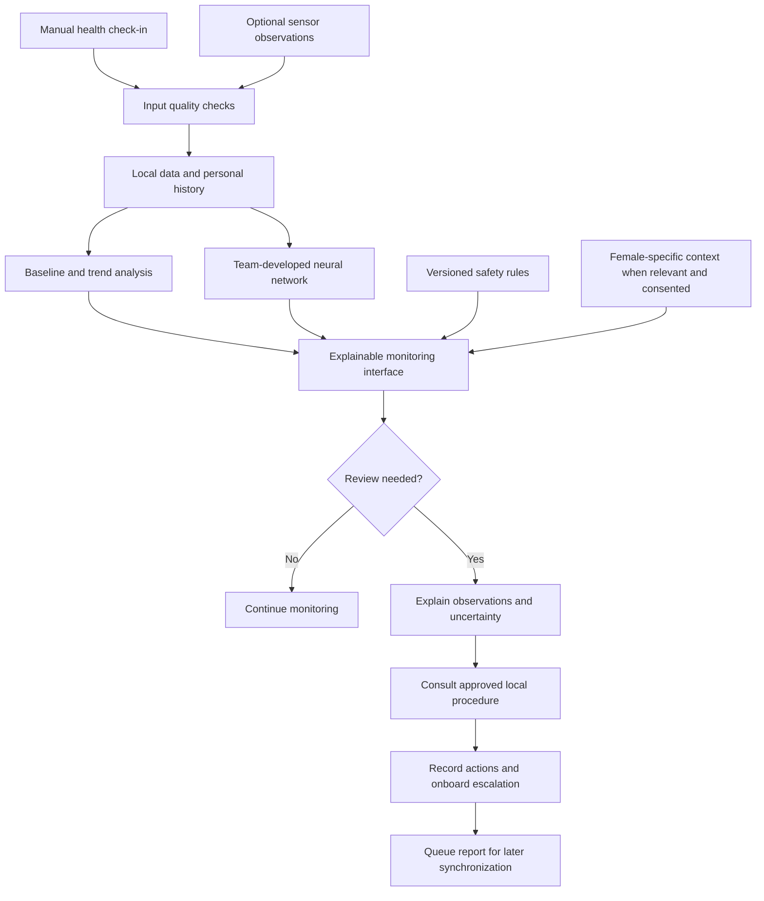

# Lyra: Crew Care — Autonomous Health Monitoring for Deep-Space Crews

**NASA Space Apps Challenge 2026** · **Health Monitoring Software for Astronauts on Space Missions**

> **Your health cannot wait for a signal from Earth.**

**Lyra: Crew Care** is a web application designed to help astronauts monitor their health during long-duration space missions, including situations in which communication with Earth is delayed or unavailable. The project brings together a **neural network developed by our team**, accessible health monitoring for **non-medical crew members**, an **individualized perspective on female health**, and an **offline-first operating model**.

The goal is not simply to display measurements. It is to help crew members understand **what changed, why it matters, what can be verified, and which approved onboard procedure to consult**—without presenting artificial intelligence as a medical professional.

> **Repository documentation note:** This README documents the product concept and provides cross-platform setup instructions for the **React + TypeScript + Vite architecture proposed in our project documentation**. The actual repository tree, package scripts, machine-learning runtime, model architecture, and evaluation metrics were **not available for inspection when this file was prepared**. Folder paths explicitly labeled *illustrative*, commands for optional components, and fields in `[BRACKETS]` must be checked against the repository before publication. Do not describe proposed features as implemented unless demonstrated.

## Table of contents

1. [Project overview](#1-project-overview)
2. [The challenge](#2-the-challenge)
3. [Key differentiators](#3-key-differentiators)
4. [System workflow](#4-system-workflow)
5. [Our neural network](#5-our-neural-network)
6. [Female-specific health analysis](#6-female-specific-health-analysis)
7. [Offline-first design](#7-offline-first-design)
8. [Technology stack](#8-technology-stack)
9. [Repository structure and files](#9-repository-structure-and-files)
10. [Prerequisites](#10-prerequisites)
11. [Run on Windows](#11-run-on-windows)
12. [Run on Linux](#12-run-on-linux)
13. [Run on macOS](#13-run-on-macos)
14. [Running the neural-network component](#14-running-the-neural-network-component)
15. [Configuration](#15-configuration)
16. [Build and production preview](#16-build-and-production-preview)
17. [Offline testing](#17-offline-testing)
18. [Demo walkthrough](#18-demo-walkthrough)
19. [Data and scientific foundations](#19-data-and-scientific-foundations)
20. [Validation and tests](#20-validation-and-tests)
21. [Privacy, safety, and limitations](#21-privacy-safety-and-limitations)
22. [Troubleshooting](#22-troubleshooting)
23. [Contributing and project links](#23-contributing-and-project-links)
24. [Pre-publication checklist](#24-pre-publication-checklist)

---

## 1. Project overview

The application is designed as an onboard health-monitoring companion for missions in which astronauts cannot depend on an immediate answer from doctors on Earth. It organizes physiological observations, personal trends, optional well-being check-ins, model-assisted analysis, and locally available guidance in a single interface.

### Who is it for?

- **Astronauts without medical training**, who need a simple, understandable interface.
- **Designated onboard medical or safety personnel**, who may need a structured record of observations and escalation events.
- **Ground-support teams**, who may receive records later when communication becomes available.
- **Researchers and developers**, who can use the prototype to study resilient, human-centered health-monitoring interactions.

### What is the intended outcome?

A crew member should be able to:

1. Record or review relevant health measurements.
2. View changes relative to their own previous observations.
3. Understand an alert's supporting evidence and uncertainty.
4. Access an **approved local procedure**, without relying on a live conversation with Earth.
5. Preserve a record of the event for follow-up and, if available, later synchronization.

**Important:** These are product objectives. The final submission should distinguish working capabilities from designs and future extensions.

## 2. The challenge

Long-duration space missions expose crews to risks related to radiation, isolation and confinement, distance from Earth, altered gravity, and hostile or closed environments. Health changes may emerge gradually, while communication delays make synchronous consultation with ground-based specialists impractical.

This creates a problem with three dimensions:

- **Scientific:** Measurements need context, individual baselines, quality checks, and careful interpretation.
- **Operational:** Critical functions cannot depend on an always-available external API or ground connection.
- **Human:** The interface needs to support a non-expert who may be tired, stressed, or working under time pressure.

The project's guiding question is:

**How can astronauts recognize meaningful changes in their own health and follow appropriate onboard procedures when immediate ground-based medical support is unavailable?**

## 3. Key differentiators

### 3.1 Team-developed neural network

The team has developed a neural network to support analysis of astronaut health information. Its intended role is to help uncover patterns and changes that might be difficult to interpret from isolated readings. The model complements—not replaces—data-quality checks, personal trends, and safety procedures.

### 3.2 Female-specific health analysis

An explicit differentiator is a more inclusive approach to health monitoring. The product design considers that **sex-related physiological factors and individual female health needs** may influence the interpretation of observations. Instead of assuming that every astronaut should be assessed through a single generic profile, the interface aims to make relevant, voluntary, personalized information available when scientifically justified.

### 3.3 Accessible to non-medical crew

The intended user experience prioritizes understandable descriptions, visible measurement units, explanations for alerts, confirmation steps, and references to approved procedures. Technical output should be translated into meaningful observations—not unexplained scores or diagnoses.

### 3.4 Designed for communication delays

The intended operating model keeps essential resources locally available, preserves events, and avoids requiring continuous contact with Earth to complete a check-in or consult already stored guidance.

### 3.5 Transparent and responsible monitoring

The project separates **model outputs**, **rule-based safety checks**, and **authorized actions**. The interface should show when data are missing, simulated, outdated, or insufficient rather than treating uncertainty as evidence of normal health.

## 4. System workflow

The following diagram represents the **target workflow**, not a claim that each component is already integrated:



### End-to-end logic

1. **Collect:** Receive manual values or supported device measurements, with timestamps, units, and data source.
2. **Validate:** Check for missing entries, invalid units, implausible data, and outdated measurements.
3. **Contextualize:** Compare observations with the astronaut's personal history and any relevant mission context.
4. **Analyze:** Use available trend analysis and the team-developed neural network as *decision support*.
5. **Explain:** Present the observations that led to a notification and communicate uncertainty.
6. **Guide:** Refer the crew member to a locally stored, approved procedure and designated onboard support.
7. **Preserve:** Record the event and, where implemented, queue information for later transmission.

> The neural network must **not** independently prescribe treatment, diagnose disease, or override validated safety procedures.

## 5. Our neural network

The neural network is one of the main technical contributions of the project. It is intended to support the identification of patterns or anomalies in the available health data, rather than serve as an autonomous diagnostic authority.

### 5.1 Intended role

- Learn from the training data and features defined by the team.
- Process health-related inputs supported by the implemented model.
- Produce model-specific outputs that can support monitoring or anomaly review.
- Complement time-series visualization and individual baselines.
- Surface uncertainty and limitations when the outputs are displayed to users.

### 5.2 Model specification — complete with verified implementation details

| Item | Information to document |
|---|---|
| **Architecture** | `[e.g., MLP, LSTM, CNN, Transformer — insert the actual architecture]` |
| **Framework** | `[e.g., PyTorch, TensorFlow, scikit-learn — only if used]` |
| **Problem formulation** | `[e.g., anomaly detection, regression, classification]` |
| **Input features** | `[exact feature names, units, sampling frequency, missing-value handling]` |
| **Output** | `[classes, scores, predictions, or other exact outputs]` |
| **Training data** | `[dataset names, provenance, permissions, and whether synthetic data were used]` |
| **Preprocessing** | `[normalization, imputation, sequence/window construction]` |
| **Evaluation** | `[split protocol and actually measured metrics]` |
| **Artifact path** | `[actual path to trained model or documented download procedure]` |
| **Inference runtime** | `[browser-side or local service; specify implementation]` |
| **Limitations** | `[known error cases, distribution shift, untested populations]` |

**No architecture, accuracy, dataset size, or clinical performance is claimed here without the team's measurements.** The README must not confuse model training on Earth-based or simulated data with clinical validation for use in microgravity.

### 5.3 Recommended inference safeguards

An integration appropriate for this domain should validate the input schema and units; retain model and dataset version identifiers; handle missing or out-of-distribution inputs explicitly; distinguish a model score from a medical conclusion; and avoid silently treating a failed model call as a reassuring result.

The team should also document whether the model can execute **locally and offline**. A browser-only interface is not fully autonomous if its only inference endpoint is a remote server that requires Earth connectivity.

### 5.4 Reproducibility

The final repository should explain how to obtain permitted datasets, install training dependencies, reproduce preprocessing, run evaluation, and identify the exact model artifact used by the demo. Training and inference commands must reference the real scripts and environment of this repository; see [Section 14](#14-running-the-neural-network-component).

## 6. Female-specific health analysis

A distinguishing product goal is to avoid a one-size-fits-all approach to astronaut health monitoring. Physiological baselines, symptoms, and relevant health histories can vary across individuals. An inclusive system should be designed to accommodate **female-specific health considerations where scientifically supported and relevant to the individual astronaut**.

### 6.1 Why it matters

Historically, biomedical evidence does not always represent all populations equally. For a project aimed at future crews, a generalized interpretation of measurements should not be assumed appropriate for every person without checking the underlying scientific evidence.

### 6.2 Proposed analysis dimensions

Depending on the team's implemented scope and the astronaut's informed choice, the design may consider:

- Individual physiological baselines instead of relying solely on a generic comparison group.
- Relevant sex-related physiological factors when supported by suitable reference data.
- Optional tracking of menstrual-cycle-related symptoms or reproductive-health observations **only when meaningful to the person and explicitly enabled**.
- Changes in sleep, fatigue, well-being, and other measurements in longitudinal context.
- Transparency about where scientific evidence is limited or where the model lacks representative training data.

**These examples describe possible dimensions, not a claim that every one is implemented or clinically validated.** Sex-related physiology, gender identity, individual medical history, and specific health needs are not interchangeable. The application should never infer sensitive characteristics or assume that all female astronauts have the same reproductive-health profile.

### 6.3 Privacy and inclusion requirements

- Sensitive fields should be optional and collected for a defined purpose.
- Users should understand why each field is requested and who can access it.
- Access to reproductive and well-being information should be minimized.
- The interface must be useful even when a user declines to provide optional information.
- The team should assess model performance across relevant groups **where a suitable, ethically obtained evaluation dataset exists**.
- The application must not make unsupported clinical claims based on sex, gender, or reproductive status.

### 6.4 Validation still needed

Document the real female-specific inputs collected by the current prototype, the scientific basis for using them, whether any model was trained or evaluated on representative data, and what the application actually changes in response. An interface option is not, by itself, evidence of medical personalization.

## 7. Offline-first design

**Offline-first** means the critical user journey is designed to continue when an external connection is unavailable, subject to the capabilities actually bundled with the application.

### Intended local capabilities

- Load the application shell and essential resources from a previously installed/cached version.
- Keep supported health records in local storage.
- Open existing history and guidance that have been stored locally.
- Perform calculations and inference that do not depend on a remote service.
- Queue events or reports for synchronization if that feature is implemented.

### Technical boundaries

- A progressive web app (PWA) typically needs an **initial successful load/installation** before its resources are available offline.
- Service workers normally require a secure context (**HTTPS or localhost**).
- Cached HTML and JavaScript do **not** make a remote machine-learning API available offline.
- Browser storage may be cleared by the user, device policy, or storage pressure; it is not automatically an encrypted medical-record store.
- Any synchronization, backup, encryption, authentication, or conflict-resolution capability must be tested and documented before being described as implemented.

### Offline demonstration target

1. Start the web application while connected.
2. Complete its initial load; install it if the PWA feature exists.
3. Open the dashboard and required instructions once to confirm availability.
4. Disconnect the machine from the internet.
5. Reload and try to view cached content, record an observation, inspect history, and run any **truly local** inference.
6. Reconnect and inspect queued-event behavior **only if synchronization exists**.

Record which steps work in the actual build. A disconnected demo running from a still-open tab is **not**, by itself, proof that the application can reload offline.

## 8. Technology stack

The following is the **proposed reference stack**, based on the earlier project design—not a verified dependency inventory:

| Layer | Proposed choice | Responsibility |
|---|---|---|
| Web UI | React + TypeScript | Component-based interface and typed data structures |
| Frontend tooling | Vite | Development server and production bundle |
| Offline capabilities | PWA / service worker | Cache appropriate static resources for offline loading |
| On-device storage | IndexedDB | Persist supported structured records locally |
| Visualization | `[verify actual charting library]` | Show longitudinal trends and measurements |
| Neural network | `[verify framework and model artifact]` | Analyze supported health inputs |
| Inference environment | `[browser, local Python service, or other]` | Execute the model where the application runs |
| Tests | `[verify actual test framework]` | Validate UI, data processing, and model integration |

**Do not install a Python server or machine-learning library just because it appears in a suggested architecture.** Python is necessary only if the real repository uses it for training, inference, or a local API.

## 9. Repository structure and files

### 9.1 Illustrative organization — not an inspected directory tree

The structure below is a **recommended example** of how the project might be organized. Keep only paths that actually exist, rename directories to their real counterparts, and add missing files after inspecting the repository.

```text
[project-root]/
├── README.md                      # Project overview and setup instructions
├── LICENSE                        # License, if one has been selected
├── .gitignore                     # Local artifacts and sensitive-file exclusions
├── .env.example                   # Documented configuration keys (if needed)
├── package.json                   # Frontend dependencies and npm scripts (if at root)
├── package-lock.json              # Dependency lock file, if using npm
├── index.html                     # Vite HTML entry point (if using Vite)
├── vite.config.ts                 # Vite configuration (if present)
├── tsconfig.json                  # TypeScript configuration (if present)
│
├── public/                        # Public static resources (if present)
│   ├── icons/                     # App icons
│   └── models/                    # Browser-loadable model artifacts (if used)
│
├── src/                           # Web application source code
│   ├── main.tsx                   # React bootstrap (conventional name)
│   ├── App.tsx                    # Root application component (conventional name)
│   ├── components/                # Reusable UI elements
│   ├── pages/                     # Dashboard, check-in, history, etc.
│   ├── features/                  # Feature-specific business logic
│   │   ├── monitoring/            # Measurements, history, trend analysis
│   │   ├── neural-network/        # Client-side integration, if applicable
│   │   ├── female-health/         # Optional individualized health features
│   │   ├── guidance/              # Local procedures and explanations
│   │   └── offline/               # Connectivity state and sync queue
│   ├── services/                  # APIs and local service adapters
│   ├── storage/                   # IndexedDB access and data persistence
│   ├── hooks/                     # Shared React hooks
│   ├── types/                     # TypeScript types/interfaces
│   ├── data/                      # Non-sensitive demo fixtures
│   └── styles/                    # Styling and design tokens
│
├── ml/                             # OPTIONAL: only if the repository has ML code
│   ├── requirements.txt           # Python dependencies, if applicable
│   ├── train.py                   # Example name for a training entrypoint
│   ├── evaluate.py                # Example name for evaluation code
│   ├── inference.py               # Example name for a local inference entrypoint
│   ├── notebooks/                 # Experiments, if used
│   └── models/                    # Model artifacts or retrieval instructions
│
├── docs/                           # OPTIONAL: supplementary technical docs
│   ├── architecture.md            # Components and data flow
│   ├── model-card.md              # Model training and limitations
│   ├── data-sources.md            # Sources, licenses, synthetic-data notes
│   └── validation.md              # Test scenarios and reproducible results
│
└── tests/                          # OPTIONAL: automated tests
```

**Alternative layout:** If the repository contains a `frontend/` directory with its own `package.json`, run frontend commands **inside `frontend/`**, not at the repository root. If there is a separate `backend/`, document its *actual* runtime and startup command. Do not assume a suggested file exists.

### 9.2 Understanding important file types

| File or directory | Purpose |
|---|---|
| `README.md` | Main entry point for reviewers and contributors. |
| `package.json` | Declares JavaScript dependencies and available commands under `scripts`. |
| `package-lock.json` | Locks npm dependency versions for reproducible installation. |
| `index.html` | Vite's HTML entry point when Vite is used. |
| `vite.config.*` | Configures the development server, build, plugins, and possibly PWA behavior. |
| `src/main.tsx` | Conventional React entry point; may have another name in the actual project. |
| `src/App.tsx` | Conventional top-level component, if present. |
| `src/components/` | Reusable buttons, cards, alerts, graphs, forms, etc. |
| `src/pages/` | Screen-level views, such as dashboard and historical records. |
| `src/storage/` | Database adapters; check what is actually persisted. |
| `public/` | Files copied/served as static assets; avoid placing sensitive information here. |
| `ml/` or `model/` | Possible location for data processing, training, and inference code. |
| `.env.example` | Public sample of required environment variable names; never real secrets. |
| `.gitignore` | Prevents accidental commit of dependency folders, temporary files, secrets, or sensitive data. |
| `dist/` | Common Vite production build output; generated, not source code. |

### 9.3 What should not be committed

- Real health data, identifying crew records, or private datasets without authorization.
- `.env` files containing credentials or access tokens.
- Temporary virtual environments (`.venv/`) and dependency folders (`node_modules/`).
- Large proprietary model weights or datasets without explicit rights to redistribute them.
- Generated caches, logs containing sensitive measurements, or local databases with real user information.

## 10. Prerequisites

For the **proposed Vite frontend**:

- **Git** — for cloning the project.
- **Node.js** — a version compatible with the project's Vite release. Current Vite documentation specifies Node.js **20.19+ or 22.12+**; use a currently supported compatible LTS release and confirm the project's `engines` field, if defined.
- **npm** — normally bundled with Node.js, unless this repository uses another package manager.
- A current browser (Chrome, Edge, Firefox, or Safari) with support for the application's required APIs.
- **Python (optional)** — only if the repository's actual training/inference/backend code requires it.

Check installations:

```bash
git --version
node --version
npm --version
```

### Identify the correct frontend directory and package manager

1. Locate `package.json` in the repository root or in a folder such as `frontend/`.
2. Read the `scripts` section of `package.json`. `npm run` prints the scripts available in the current package.
3. Match the package manager to the lock file:

| Lock file | Preferred install command |
|---|---|
| `package-lock.json` | `npm ci` |
| No lock file, but npm is intended | `npm install` |
| `pnpm-lock.yaml` | `pnpm install --frozen-lockfile` (pnpm required) |
| `yarn.lock` | Follow the repository's Yarn version and documentation |
| `bun.lock` / `bun.lockb` | Follow the repository's Bun version and documentation |

`npm ci` requires an npm lock file. Do **not** mix package managers casually because it may produce inconsistent dependency trees.

## 11. Run on Windows

These instructions use **PowerShell** on Windows 10/11 and assume the Vite frontend architecture described above.

### Step 1 — Install prerequisites

Install **Git for Windows** from <https://git-scm.com/download/win> and a compatible **Node.js LTS** version from <https://nodejs.org/>. Open a fresh PowerShell terminal and verify:

```powershell
git --version
node --version
npm.cmd --version
```

Using `npm.cmd` in PowerShell avoids situations where the PowerShell script shim (`npm.ps1`) is blocked by execution policy.

### Step 2 — Clone the repository

```powershell
git clone https://github.com/OWNER/REPOSITORY.git
cd REPOSITORY
```

Replace `OWNER` and `REPOSITORY` with the real GitHub owner and repository name. If the code is already downloaded, just open PowerShell in its directory.

### Step 3 — Enter the frontend package

```powershell
# Only enter frontend/ when that is where package.json exists.
if (Test-Path ".\frontend\package.json") {
    Set-Location ".\frontend"
} elseif (-not (Test-Path ".\package.json")) {
    throw "No package.json found in the root or frontend/. Check the repository layout."
}
```

### Step 4 — Install JavaScript dependencies

```powershell
if (Test-Path ".\package-lock.json") {
    npm.cmd ci
} else {
    npm.cmd install
}
```

**Only use this npm branch if the repository is an npm project.** If you find `pnpm-lock.yaml`, `yarn.lock`, or a Bun lock file, use that package manager instead.

### Step 5 — Inspect scripts and launch the web application

```powershell
npm.cmd run
npm.cmd run dev
```

Open the local address printed in the terminal. For a default Vite project it is usually **<http://localhost:5173>**, but the configured port can differ.

Stop the development server with **Ctrl + C**.

## 12. Run on Linux

The steps below apply to Ubuntu, Debian, Fedora, and similar distributions, with package-installation details varying by distribution.

### Step 1 — Install Git and a compatible Node.js version

On Ubuntu/Debian, Git can be installed with:

```bash
sudo apt update
sudo apt install -y git
```

Install a **compatible Node.js LTS** version from <https://nodejs.org/> or with your preferred maintained version manager. Distribution `apt` packages may lag behind the version required by Vite, so **verify the version rather than assuming it is new enough**.

```bash
git --version
node --version
npm --version
```

### Step 2 — Clone and find the frontend

```bash
git clone https://github.com/OWNER/REPOSITORY.git
cd REPOSITORY

if [ -f frontend/package.json ]; then
  cd frontend
elif [ ! -f package.json ]; then
  echo "No package.json found in the root or frontend/." >&2
  exit 1
fi
```

The conditional block is intended for a Bash terminal. If your shell behaves differently, enter the directory containing `package.json` manually.

### Step 3 — Install dependencies and run

```bash
if [ -f package-lock.json ]; then
  npm ci
else
  npm install
fi

npm run
npm run dev
```

Use the package manager matching the real lock file, as explained in [Section 10](#10-prerequisites). Open the local address displayed by the dev server (commonly <http://localhost:5173>). Stop it with **Ctrl + C**.

## 13. Run on macOS

The following steps work on macOS with Terminal (or another compatible shell), on Apple silicon or Intel Macs, provided the project's dependencies support the machine.

### Step 1 — Install prerequisites

Install Git and a compatible Node.js LTS version from their official websites. If you already use Homebrew, an optional route is:

```bash
brew install git node
```

If `brew` is not installed, use the official installers; Homebrew is **not** required.

Verify:

```bash
git --version
node --version
npm --version
```

### Step 2 — Clone and enter the package

```bash
git clone https://github.com/OWNER/REPOSITORY.git
cd REPOSITORY

if [ -f frontend/package.json ]; then
  cd frontend
elif [ ! -f package.json ]; then
  echo "No package.json found in the root or frontend/." >&2
  exit 1
fi
```

### Step 3 — Install and start

```bash
if [ -f package-lock.json ]; then
  npm ci
else
  npm install
fi

npm run
npm run dev
```

Open the address shown in Terminal. For the default Vite port, visit <http://localhost:5173>. Stop with **Control + C**.

## 14. Running the neural-network component

**The team has developed a neural network, but its repository paths, exported format, inference command, and runtime were not supplied for this README.** Accordingly, the following procedures are **conditional**. They are not evidence that the named scripts or folders exist.

### Option A — Model runs inside the browser

If the team exported the trained model to a browser-compatible format and implemented client-side inference:

1. Verify that the model artifact is present at the path expected by the application or that a documented local-download step is complete.
2. Install and start the web project following [Sections 11–13](#11-run-on-windows).
3. Open the relevant model-assisted analysis screen.
4. Test that inference does not issue a mandatory request to an external server.
5. For genuine offline capability, ensure model artifacts are also cached/available locally.

In this case, **Python may be required for training but not to run the web application**.

### Option B — Python training/inference component exists

Only follow these commands **if the repository actually contains Python code and a requirements file**. The example below assumes `ml/requirements.txt` exists relative to the repository root; change the path to match the project.

**Windows PowerShell (from repository root):**

```powershell
py -3 -m venv .venv
.\.venv\Scripts\python.exe -m pip install -r .\ml\requirements.txt

# Inspect the real ML files before choosing the entrypoint:
Get-ChildItem .\ml -Recurse -File

# Example ONLY if ml/inference.py exists and supports --help:
# .\.venv\Scripts\python.exe .\ml\inference.py --help
```

**Linux / macOS (from repository root):**

```bash
python3 -m venv .venv
.venv/bin/python -m pip install -r ml/requirements.txt

# Inspect the real ML files before choosing the entrypoint:
find ml -maxdepth 3 -type f

# Example ONLY if ml/inference.py exists and supports --help:
# .venv/bin/python ml/inference.py --help
```

Using the virtual environment's interpreter directly avoids needing to activate it in the terminal. If the project uses `pyproject.toml`, Conda, Poetry, uv, or a different structure, follow **that project's actual dependency specification instead**.

### Option C — Local API or separate backend exists

If inference runs in a local service, the README must identify:

- The backend's **actual directory**, runtime, and installation method.
- The **actual command** used to start the backend.
- The host and port used to reach it from the web interface.
- The endpoint request/response schema and expected model artifact.
- How the service operates when external communication is unavailable.

**Placeholder to replace with your verified startup instructions:**

```text
Backend directory: [ACTUAL_DIRECTORY]
Install command:    [ACTUAL_COMMAND]
Start command:      [ACTUAL_COMMAND]
Local address:      [ACTUAL_ADDRESS]
Model artifact:     [ACTUAL_PATH]
```

Never claim offline neural-network inference if the application relies on a remote/cloud inference endpoint.

## 15. Configuration

If the repository provides an `.env.example` file, copy it to the appropriate local `.env` file before starting the development server. **Do not create imaginary environment variables or commit real secrets.**

### Windows PowerShell

```powershell
if (Test-Path ".\.env.example") {
    Copy-Item ".\.env.example" ".\.env"
}
```

### Linux / macOS

```bash
if [ -f .env.example ]; then
  cp .env.example .env
fi
```

Document the meaning, permitted values, defaults, and security implications of each **actual** configuration key. In Vite, variables intentionally exposed to browser-side code commonly use the `VITE_` prefix; **do not put credentials or secrets in browser-exposed variables**.

Configuration to confirm before publishing:

| Question | Repository-specific answer |
|---|---|
| Where is the frontend `package.json`? | `[PATH]` |
| Which package manager is used? | `[npm / pnpm / yarn / bun]` |
| What command starts development? | `[SCRIPT]` |
| Is there a separate inference service? | `[YES / NO]` |
| How is the trained model loaded? | `[LOCAL PATH / BROWSER / SERVICE]` |
| Where are demo datasets stored? | `[PATH OR GENERATOR]` |
| Which variables are required? | `[KEYS WITHOUT SECRET VALUES]` |
| Which functions are confirmed offline? | `[VERIFIED LIST]` |

## 16. Build and production preview

For a Vite frontend whose `package.json` provides the conventional `build` and `preview` scripts, run these commands **from the frontend package directory**:

```bash
npm run build
npm run preview
```

The conventional output folder is `dist/`, and the preview server commonly uses <http://localhost:4173>. Both may differ in the project's configuration.

**Windows PowerShell equivalent:**

```powershell
npm.cmd run build
npm.cmd run preview
```

A successful build confirms that bundling completed; it does **not** establish medical safety, full offline behavior, or reliability of the neural network.

## 17. Offline testing

Offline operation is a critical proposed differentiator. Test it explicitly rather than assuming that using a web app or PWA makes all features autonomous.

### Suggested reproducible test

1. Run the application's **production build** on a local server, or use its deployed HTTPS version.
2. Load the application while online, allowing essential resources to be cached according to its service-worker implementation.
3. Open the pages and procedures needed for the scenario and create a **synthetic** test record.
4. In browser DevTools, inspect the service worker, network activity, and local storage behavior.
5. Switch the browser's network simulation to **Offline** or disable the network connection.
6. Reload the application and verify that expected screens still open.
7. Attempt a new check-in; verify that it persists across navigation or reloads if that is a product requirement.
8. Attempt AI inference **only if the model is genuinely local**.
9. Restore connectivity and inspect synchronization **only if a sync system exists**.
10. Record the observed result, browser, operating system, build version, and any failures.

### Evidence table to complete after running tests

| Scenario | Expected result | Actual result | Evidence |
|---|---|---|---|
| Offline reload | App shell loads from locally available resources | `[PASS/FAIL/NOT TESTED]` | `[LINK]` |
| Offline record | Observation is stored without network | `[PASS/FAIL/NOT TESTED]` | `[LINK]` |
| Offline history | Previous measurements remain readable | `[PASS/FAIL/NOT TESTED]` | `[LINK]` |
| Offline guidance | Approved local content remains accessible | `[PASS/FAIL/NOT TESTED]` | `[LINK]` |
| Offline model | Inference works without external API, if supported | `[PASS/FAIL/NOT TESTED]` | `[LINK]` |
| Reconnection | Queued reports sync safely, if supported | `[PASS/FAIL/NOT TESTED]` | `[LINK]` |

## 18. Demo walkthrough

The following is a **suggested narrative** for a prototype demo. Adapt all interactions to the features that truly work.

1. **Mission context:** Present a fictitious deep-space mission and explain why immediate medical support is unavailable.
2. **Crew check-in:** Enter synthetic health observations with explicit timestamps and units.
3. **Historical trend:** Show how a current observation compares with the crew member's personal baseline.
4. **Neural-network contribution:** Display the actual model's supported output and explain what the output means **without implying a diagnosis**.
5. **Female-specific analysis:** Demonstrate the actual relevant feature, if implemented, using consented synthetic examples. Clarify what changes in the analysis and why.
6. **Interpretable alert:** Explain which observations deserve attention, what information is uncertain, and what is still missing.
7. **Onboard next step:** Open pre-approved guidance or show how the crew member can reach the designated onboard support role.
8. **Communication loss:** Disconnect the network and demonstrate the features proven to work offline.
9. **Wrap-up:** Show the event record and, if present, an asynchronous report queue.

### Suggested project assets

- Demo video: `[VIDEO_URL]`
- Live prototype: `[APPLICATION_URL]`
- Screenshots: `[ACTUAL_SCREENSHOT_PATHS]`
- Technical architecture: `[ARCHITECTURE_DOCUMENT_PATH]`
- Model card and reproducibility notes: `[MODEL_CARD_PATH]`

Do not add broken links or claim that these assets already exist.

## 19. Data and scientific foundations

NASA resources can inform problem framing, biological risk selection, and the design of responsible demonstrations. **Referencing these sources does not mean their datasets were necessarily used to train the neural network.**

| Source | Relevance | Important caveat |
|---|---|---|
| [NASA Human Research Program](https://www.nasa.gov/hrp/hazards/) | Health hazards and risks associated with human spaceflight | Scientific reference, not live crew telemetry |
| [NASA Human Spaceflight Risks](https://www.nasa.gov/hrp/risks/) | Evidence and framing for human health risks | Research findings are not individualized diagnoses |
| [NASA Open Science Data Repository](https://science.nasa.gov/biological-physical/data/osdr/) | Space biology and associated research data | Datasets vary in organism, modality, access, and relevance |
| [NASA Life Sciences Portal](https://nlsp.nasa.gov/) | Life-sciences studies and related resources | Some human data may have access restrictions |
| [NASA Human Spaceflight Standards](https://www.nasa.gov/ochmo/human-spaceflight-and-aviation-standards/) | Human factors and crew-health requirements | Citing standards does not establish compliance |
| [NASA Open APIs](https://api.nasa.gov/) | Optional mission/environmental context | Space-weather events are not direct individual dose measurements |

### Actual datasets used

Before submission, replace this section with a **specific table** containing each actual dataset or generated data source, its link or citation, license/access status, participant or organism type, features selected, preprocessing, and role in training versus demonstration.

| Dataset | Source | Real or synthetic | Used for | License/access |
|---|---|---|---|---|
| `[DATASET_NAME]` | `[URL/CITATION]` | `[REAL/SYNTHETIC]` | `[TRAINING/EVALUATION/DEMO]` | `[TERMS]` |

Use explicit **SIMULATED DATA** labels in UI captures or demos that show generated astronaut health records. Never present synthetic measurements as real astronaut observations.

## 20. Validation and tests

### Functional verification

At a minimum, check relevant implemented scenarios:

- A normal check-in with complete, valid measurements.
- An abnormal or changing **synthetic** trend, with an understandable explanation.
- Missing, stale, or inconsistent readings.
- Persistence after navigating away or reloading.
- Loss of network connectivity during a check-in.
- Offline access to core guidance, where supported.
- Model load failure and invalid model input.
- A user declining optional female-specific information.
- Accessibility using keyboard, sufficient contrast, and non-specialist language.

### Model evaluation

Document the dataset split and leakage controls; evaluation measures appropriate for the actual prediction task; performance on held-out samples; class imbalance if applicable; error cases; and the limitations of the target population. **Do not invent accuracy, sensitivity, specificity, AUROC, or F1 scores.** If the application refers to a predicted risk, establish what was actually predicted and how the value was calibrated.

### Running automated tests

Only run commands that actually exist in `package.json` or the project's Python test configuration. For example:

```bash
npm run                  # List available npm scripts
# npm run test            # Only if the test script exists
# npm run lint            # Only if the lint script exists
# python -m pytest        # Only if a Python test suite is configured
```

## 21. Privacy, safety, and limitations

> **Research and educational prototype — not a certified medical device.**
>
> This application is not a substitute for clinicians, does not diagnose diseases, does not prescribe treatment, does not guarantee emergency detection, and has not been certified for spaceflight operations. Any real mission deployment would require independent medical, security, human-factors, and systems validation.

### Medical safety

- Use approved procedures for safety-critical actions rather than free-form AI instructions.
- Show relevant evidence, provenance, and uncertainty with alerts.
- Clearly distinguish model output from clinical interpretation.
- Never treat missing data as normal findings.
- Avoid unvalidated thresholds borrowed directly from Earth-based populations.
- Escalate urgent situations according to the mission's onboard protocols rather than waiting solely for a response from Earth.

### Data protection

- Minimize personal and sensitive data collection.
- Obtain appropriate consent for optional information, including reproductive-health details.
- Restrict access based on actual onboard roles if account management is implemented.
- Do not claim encryption or secure synchronization unless these controls are implemented and tested.
- Do not store real health records in test fixtures, public repositories, or `public/` assets.
- Keep personally sensitive fields out of diagnostic logs and demo screenshots.

### Model and inclusion limitations

An AI model may reflect biases in its source data and may not generalize to astronauts under altered gravity, radiation exposure, or extended isolation. Individual health variation and differences among female astronauts require suitable evidence; they cannot be handled safely through an arbitrary universal adjustment factor. The prototype should be evaluated for failures and inequities before making clinical claims.

## 22. Troubleshooting

| Problem | Likely cause | What to check |
|---|---|---|
| `git: command not found` | Git is not installed or not on `PATH` | Install Git and reopen the terminal. |
| `node: command not found` | Missing Node.js or a `PATH` issue | Install a compatible Node.js LTS version; verify with `node --version`. |
| Vite rejects Node.js version | Incompatible Node release | Update Node according to Vite and the project's `engines` specification. |
| `npm ci` fails without a lock file | No `package-lock.json` | Use `npm install` only if npm is the intended manager, or the matching lock-file manager. |
| `Missing script: dev` | `package.json` has no `dev` script | Run `npm run`, inspect `scripts`, and use the real startup command. |
| `ENOENT package.json` | Commands were run from the wrong folder | Locate `package.json` in the root or a nested frontend folder. |
| PowerShell blocks `npm.ps1` | Script execution policy | Try `npm.cmd` instead of changing system security settings. |
| Port `5173` is occupied | Another service is listening | Use the URL printed by Vite or a configured alternate port. |
| Application works online but not offline | Missing/incomplete service-worker cache or external API dependency | Test the production build, inspect Network/Storage panels, and confirm all required resources are local. |
| Model file cannot be loaded | Wrong path, incompatible format, or missing artifact | Check the actual model export, paths, MIME handling, and runtime dependencies. |
| Python install fails | Wrong Python environment or dependency version | Verify the project's Python version, dependency file, and virtual environment. |
| Graphs or alerts show unexpected results | Missing data, invalid units, test fixture, or model mismatch | Inspect input validation, timestamps, unit conversions, and the exact model version. |

When reporting a problem, include the operating system, Node/Python versions as applicable, exact command executed, complete error output **with secrets removed**, and the relevant commit ID.

## 23. Contributing and project links

### Contributing

Contributions should prioritize reproducible changes, clear documentation, test coverage, and protection of health-related information. Contributors should not introduce medical claims, unvalidated intervention advice, or real personal records in demonstration data.

A typical contribution workflow is:

```bash
git checkout -b feature/short-description
# Make and test changes
git add .
git commit -m "Describe the change"
git push -u origin feature/short-description
```

Open a pull request against the project's designated development branch and explain what changed, how it was tested, and whether it affects model outputs or safety-related behavior.

### NASA Space Apps Challenge

- Challenge: <https://www.spaceappschallenge.org/2026/challenges/health-monitoring-software/>
- Project page: `[SPACE_APPS_PROJECT_URL]`
- Demo video: `[VIDEO_URL]`
- Live app: `[APPLICATION_URL]`
- Source repository: `[REPOSITORY_URL]`

### Team

- Team name: `[TEAM_NAME]`
- Members and roles: `[NAMES_AND_ROLES]`
- Contact: `[PUBLIC_CONTACT_OR_ISSUE_TRACKER]`

### License

**License: `[CHOSEN_LICENSE]`**. Include a real `LICENSE` file only after the team selects the distribution terms. Third-party datasets, code, icons, and model artifacts may have independent license or attribution requirements.

---

## 24. Pre-publication checklist

> Maintainers: **complete this section before linking the README in the NASA submission**. These are editorial checks, not features already verified.

- [ ] Add the official team name and repository/demo links for **Lyra: Crew Care**.
- [ ] Confirm the repository's **actual** package manager, runtime versions, and install/start commands.
- [ ] Replace the illustrative directory tree with the **real** directory and file names.
- [ ] Identify the exact model architecture, input features, output format, dependencies, artifact path, and invocation route.
- [ ] Provide model-training and evaluation provenance, with **measured** metrics only.
- [ ] Explain what female-specific information is actually collected, how consent works, and how it changes analysis.
- [ ] Mark implemented, partially implemented, and proposed features accurately.
- [ ] Verify the offline demo from a cold reload and test whether inference really works without an external API.
- [ ] Document which NASA datasets were actually used and distinguish them from background references.
- [ ] Review all medical statements and remove unsupported clinical claims.
- [ ] Confirm no secrets, private medical records, unlicensed datasets, or restricted model weights are committed.
- [ ] Add real screenshots, demo video, instructions for reproducing the featured scenario, and appropriate licenses.
- [ ] Remove this checklist and the introductory documentation note only after its issues are resolved.

---

### References for development tooling

- [Vite — Getting Started](https://vite.dev/guide/)
- [Vite — Deploying a Static Site](https://vite.dev/guide/static-deploy)
- [npm — `npm ci`](https://docs.npmjs.com/cli/v11/commands/npm-ci/)
- [Python — `venv`](https://docs.python.org/3/library/venv.html)
- [MDN — Service Worker API](https://developer.mozilla.org/en-US/docs/Web/API/Service_Worker_API)

*Developed for the NASA Space Apps Challenge. Not an official NASA product, NASA-endorsed service, or flight-certified medical system.*
